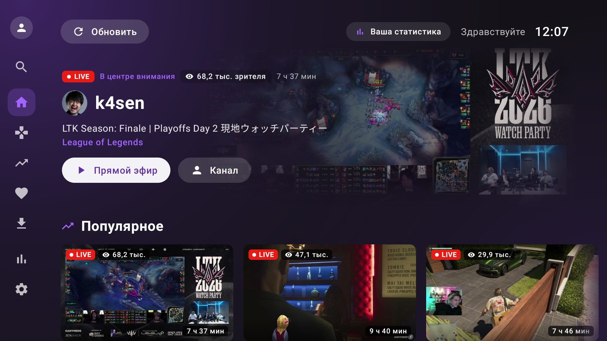
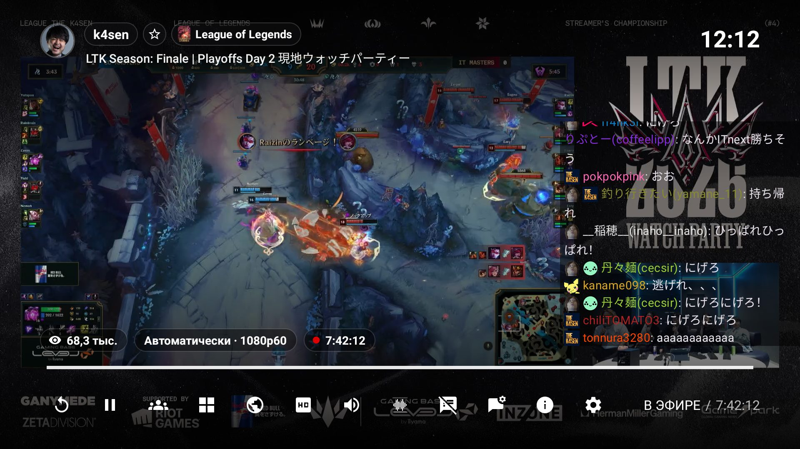
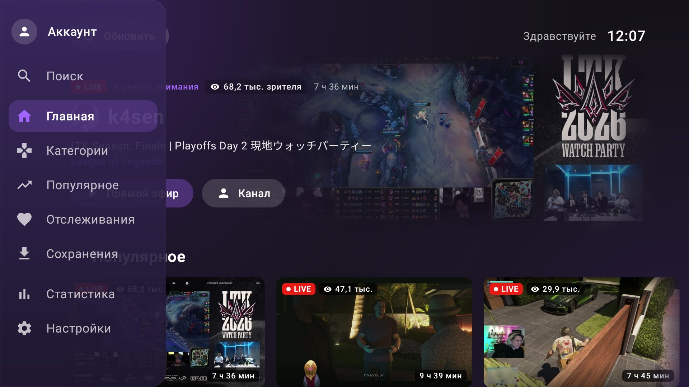
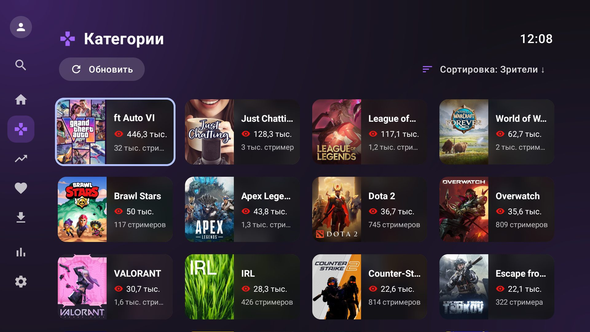
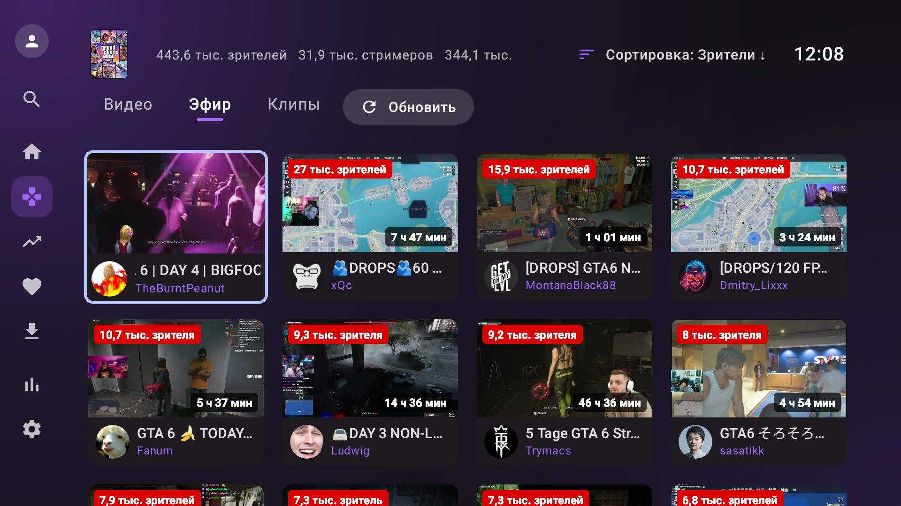
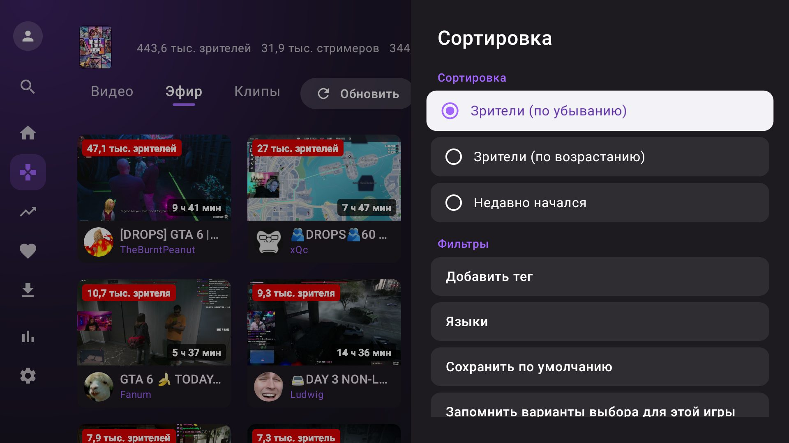
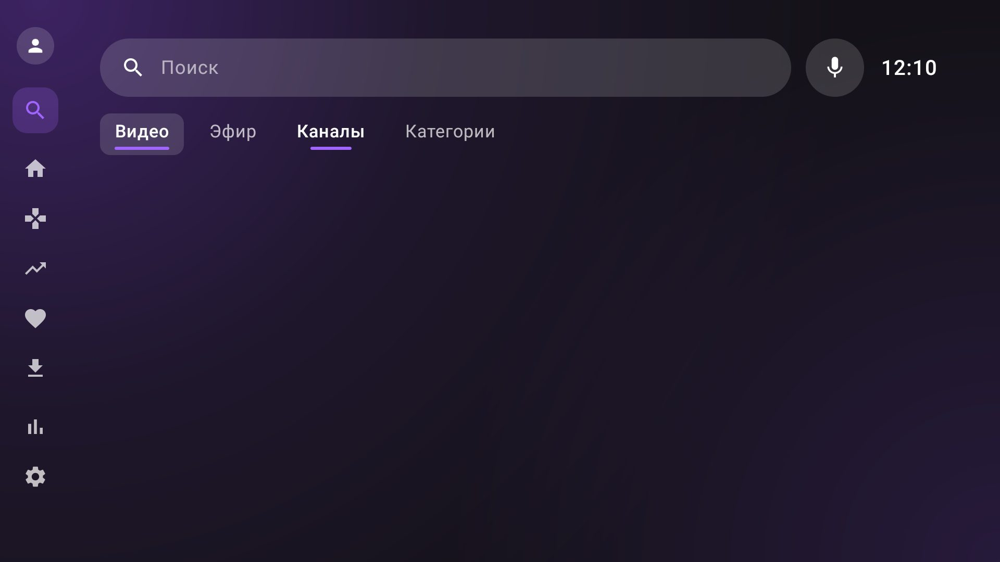

# TwitchPro


**TwitchPro** — плеер и браузер Twitch, созданный для **Android TV** на основе [Xtra](https://github.com/crackededed/Xtra).
Полноценный TV-интерфейс, спроектированный под пульт, встроенный блокировщик рекламы (Proxy & VAFT), стримы до **1440p60**, мультистрим до 6 каналов, живая DVR-шкала и многое другое.

<br clear="left"/>

<p align="center">
  
  
</p>

## Установка

Скачайте последний APK со страницы [Релизов](https://github.com/endlessbum/twitchpro/releases/latest).

На ТВ проще всего через приложение **Downloader** (или любой файловый менеджер): скачайте APK и установите его (разрешите установку неизвестных приложений для этого приложения). С компьютера: `adb install TwitchPro.apk`.

TwitchPro имеет собственное имя пакета и устанавливается **рядом** с оригинальным Xtra / Xtra TV как отдельное приложение: настройки и вход не переносятся автоматически (для переноса используйте функцию бэкапа/восстановления в настройках ТВ).

## Возможности

- **Создано для Android TV**: боковое меню Leanback, ряды живых каналов и категорий, мгновенные превью без рекламы прямо внутри карточки в фокусе, голосовой поиск и быстрые действия с пульта.
- **Встроенный блокировщик рекламы (Proxy & VAFT)**: автоматически переключается на прокси или стрим без рекламы во время pre-roll и mid-roll рекламы с живым индикатором прогресса и возвратом к основному стриму почти без задержки.
- **До 1440p60 - 4K (Enhanced Broadcasting)**: автоматически включает максимальное доступное качество стрима на Wi-Fi / Ethernet, с подгонкой частоты обновления экрана и нормализацией громкости (в том числе во время рекламных пауз).
- **Мультистрим и Picture-in-Picture**: смотрите до **6 живых стримов одновременно** (рядом, сеткой или в режиме фокуса) с чатами, предложениями стримов той же категории, живым поиском и раздельным управлением звуком — или откройте второй стрим в плавающем окне PiP.
- **Живой DVR и подписочные VOD**: перематывайте любой прямой эфир по шкале с живыми превью видео и смотрите VOD, доступные только подписчикам.
- **Настраиваемый ТВ-чат и быстрое переключение стримов**: чат как оверлей, боковая панель или нижняя бегущая строка (с голосовым вводом), мгновенное переключение между живыми каналами кнопками Left / Right или Channel Up / Down.
- **Резервная копия настроек по QR-коду**: сохраняйте и восстанавливайте настройки прямо на ТВ или переносите их на телефон по Wi-Fi, сканируя QR-код.

## Вход

Два способа на ТВ: **код для ввода на twitch.tv/activate** с телефона или компьютера, либо **страница входа Twitch** внутри приложения.

## 1440p - 4K (Enhanced Broadcasting)

Twitch отдаёт стримы 1440p - 4K только клиенту сайта с залогиненным аккаунтом. Чтобы включить их:
1. Войдите через **страницу входа Twitch** в приложении (вход по коду не даёт 1440p - 4K).
2. Публичные прокси останавливаются на 1080p: используйте встроенный блокировщик рекламы или собственный прокси.
3. Держите включённой опцию передачи токена для стримов (включена по умолчанию).
4. Ваш ТВ должен поддерживать аппаратное декодирование **H.265 (HEVC)** или **AV1**.

## Скриншоты

| | |
|:-:|:-:|
|  |  |
| Боковое меню Leanback | Главная с рядами и живым превью |
|  |  |
| Плеер с HUD и чат-оверлеем | Мультистрим (до 6 стримов) |
|  |  |
| Игры | Категория с живым превью |
|  |  |
| Панель сортировки и фильтров | Голосовой поиск |

## Глубокие ссылки и автоматизация

TwitchPro открывает живые стримы, страницы каналов, VOD (с таймкодами), клипы и категории прямо из ADB, Home Assistant, tvQuickActions или кастомных лаунчеров. Все поддерживаемые URL и примеры — в [**docs/deeplinks.md**](docs/deeplinks.md).

## Сборка

```bash
./gradlew assembleRelease
```
APK генерируется в `app/build/outputs/apk/release/`.

## Благодарности

TwitchPro — форк [Xtra](https://github.com/crackededed/Xtra) (автор оригинала — [AndreyAsadchy](https://github.com/AndreyAsadchy/Xtra)).
Блокировщик рекламы следует логике userscript [VAFT](https://github.com/pixeltris/TwitchAdSolutions).

## Лицензия

TwitchPro распространяется под лицензией [GNU Affero General Public License v3.0](LICENSE).
